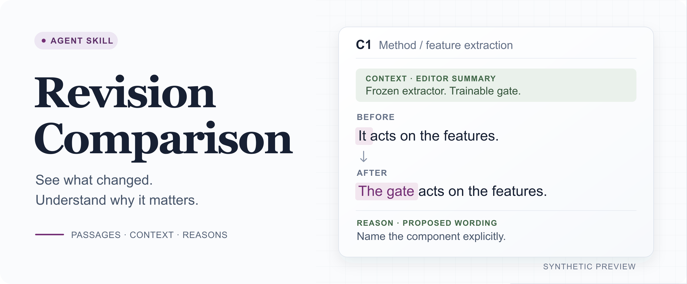

# Revision Comparison

<p align="center">
  
</p>

<p align="center">
  <a href="#quick-start">Quick start</a> ·
  <a href="#install">Install</a> ·
  <a href="#examples">Examples</a> ·
  <a href="#how-it-works">How it works</a> ·
  <a href="skills/revision-comparison/SKILL.md">Skill instructions</a> ·
  <a href="LICENSE">MIT license</a>
</p>

Review a revision with the original passage, revised passage, and reason together. Revision Comparison is an agent skill for academic papers and technical documents. It adds the context a reader needs to understand an edit: the acting component, a nearby definition, a distant assumption, or the passage's role in its section.

Compare two supplied drafts, or give the agent one draft and an editing goal so it can propose a revision. Both produce a separate review document with exact quotations, locations, and change IDs. Applying edits to the manuscript is a separate request.

A small [synthetic example](examples/language-edit/comparison.md), from Method, paragraph 2 in both versions:

> **Context — editor summary of Method, paragraph 1:** frozen extractor; trainable gate.<br>
> **Before:** It acts on $h(x)$, and it controls which coordinates reach the classifier.<br>
> **After:** The gate $g_\theta$ acts on $h(x)$ and controls which coordinates reach the classifier.<br>
> **Reason — editor-proposed:** name the component and remove the repeated subject.

## Quick start

[Install the skill](#install), open your manuscript project in the agent, then paste one of these prompts. Replace the sample paths with your own.

### Compare two drafts

```text
Use revision-comparison in compare mode.
Before: drafts/method-v1.tex
After: drafts/method-v2.tex
Scope: the feature-extraction subsection.
Save the Markdown comparison as review/method-comparison/comparison.md.
Explain the differences in English. Preserve both supplied versions.
```

### Propose a language edit

```text
Use revision-comparison in propose-and-compare mode on paper/method.tex.
Scope: the feature-extraction subsection.
Editing scope: language-only.
Goal: clarify which operation acts on the frozen features.
Preserve the claims, notation, equations, numbers, and citations.
Use the optional academic style profile.
Save the Markdown comparison as review/method-proposal/comparison.md.
Do not apply the proposal to the manuscript.
```

**Open the result:** the output directory contains the Markdown comparison, preserved input snapshots, and version identities. A proposal also includes the authoritative revised text. Read the overview for coverage, then use change IDs such as C1 to discuss individual edits. [See a complete example](examples/language-edit/comparison.md).

These are prompts for your agent. The repository supplies instructions and assets; it does not contain a standalone revision command.

## Install

The commands below need Git and Python 3.8+. The skill runs in an agent that can read and write local files. The installer copies the complete [`skills/revision-comparison`](skills/revision-comparison) directory, including its references and LaTeX annotation asset.

### Codex · user installation

Copy this block into your terminal from a directory where the new clone should live:

```sh
git clone https://github.com/Raiden-Zhu/revision-comparison-skill.git
cd revision-comparison-skill
python3 scripts/install.py
```

Destination: `~/.agents/skills/revision-comparison`. If you have already cloned the repository, run only the last command from its root. While this repository is private, Git access is required; use your normal GitHub authentication.

### Claude Code · user installation

From the cloned repository root:

```sh
python3 scripts/install.py --agent claude-code
```

Destination: `~/.claude/skills/revision-comparison`.

### Install in one project

Choose one command and replace `/absolute/path/to/project` with an existing project directory. Run it from the cloned repository root.

Codex:

```sh
python3 scripts/install.py --scope project --project "/absolute/path/to/project"
```

Claude Code:

```sh
python3 scripts/install.py --agent claude-code --scope project --project "/absolute/path/to/project"
```

| Agent | User installation | Project installation |
| --- | --- | --- |
| Codex | `~/.agents/skills/revision-comparison` | `<project>/.agents/skills/revision-comparison` |
| Claude Code | `~/.claude/skills/revision-comparison` | `<project>/.claude/skills/revision-comparison` |

Start a new agent session or follow your host's skill reload instructions. In Codex, select `$revision-comparison`; in Claude Code, invoke `/revision-comparison`. Then provide one of the [quick-start prompts](#quick-start).

<details>
<summary>Custom paths, existing installations, and other agents</summary>

An exact custom destination overrides the host and scope defaults:

```sh
python3 scripts/install.py --dest "/custom/skills/revision-comparison"
```

For an older Codex setup that discovers skills in `CODEX_HOME/skills`, choose that location explicitly:

```sh
python3 scripts/install.py --dest "${CODEX_HOME:-$HOME/.codex}/skills/revision-comparison"
```

The installer refuses an existing destination, including a symbolic link, and reports its location. Review an existing installation before updating it. There is no force-overwrite option; a copy failure retains the partial directory for inspection.

Other file-capable agents can read [`SKILL.md`](skills/revision-comparison/SKILL.md) directly and follow its relative references. Automatic discovery depends on the host. The skill itself needs no Python runtime; Python is used only by this optional installer. Manual installation should copy the whole skill directory.

```sh
python3 scripts/install.py --help
```

</details>

## Examples

All examples use synthetic material. Each includes the original, revised text, comparison, and file identities.

| Example | What to look for | Open |
| --- | --- | --- |
| Language edit | Name the acting component; preserve the frozen-extractor condition | [Report](examples/language-edit/comparison.md) · [Before](examples/language-edit/before.md) · [After](examples/language-edit/after.md) |
| Structure edit | Track moved and merged passages without losing their source locations | [Report](examples/structure-edit/comparison.md) · [Before](examples/structure-edit/before.md) · [After](examples/structure-edit/after.md) |
| Meaning review | Expose a removed condition and an uncertain objective reformulation | [Report](examples/semantic-review/comparison.md) · [Before](examples/semantic-review/before.md) · [After](examples/semantic-review/after.md) |
| Mathematical text | Keep formulas readable in Markdown and a compiled PDF comparison | [Report](examples/math/comparison.md) · [PDF](examples/math/comparison.pdf) · [LaTeX source](examples/math/comparison.tex) |

The banner is a shortened illustration of the [language-edit example](examples/language-edit/comparison.md). Its context is an editor summary; the full report supplies the actual definition and both exact passages with locations. The [SVG source](assets/readme-hero.svg) is editable.

**Try the included material:** open the cloned repository in your agent and paste this prompt. No manuscript is needed.

```text
Use revision-comparison in compare mode.
Before: examples/language-edit/before.md
After: examples/language-edit/after.md
Scope: both complete files. Preserve the supplied versions.
Save a new Markdown comparison as review/example-run/comparison.md.
```

## How it works

`compare` preserves both supplied versions, including any errors, and reports concerns separately. `propose-and-compare` creates one revised version within your editing scope, then traces that same text throughout the report. The optional academic profile guides that writing step.

Author explanations are labeled as provided reasons. If the agent interprets someone else's edit without an explanation, the reason is labeled as inferred. Language-only proposals preserve claims, notation, numbers, equations, citations, and document structure. Structural work needs an authorized scope; scientific changes need relevant evidence. See the [core instructions](skills/revision-comparison/SKILL.md) for the contract.

### More prompts

**Grammar across a manuscript:** provide the entry file and ask for coverage of its included text. Large documents may need several passes; the report should state which sections were covered.

```text
Use revision-comparison in propose-and-compare mode on paper/main.tex.
Follow the manuscript's included files in reading order.
Editing scope: language-only.
Brief: correct grammar and punctuation throughout the manuscript.
Retain sentence structure where possible and preserve terminology,
author voice, claims, equations, numbers, and citations.
Save the proposal and comparison in review/grammar/; do not apply edits.
Record covered sections and any text you could not inspect.
```

**Use paper notes as context:** keep the manuscript as the baseline. Notes can explain a definition or goal; they do not replace the original passage.

```text
Use revision-comparison in propose-and-compare mode on paper/intro.tex.
Read notes/paper-context.md for the intended audience and definitions.
Editing scope: language-only. Goal: clarify the motivation paragraph.
Identify which context comes from the notes and which from the manuscript.
Save a Markdown comparison in review/intro/; do not apply edits.
```

### Apply selected edits

Applying changes is independent of the two content modes. Request it explicitly and identify the version or changes to apply.

```text
Apply C1 and C3 from review/method-proposal/comparison.md to
paper/method.tex. Keep the remaining passages as they are.
Preserve a baseline and deliver a clean manuscript.
```

If you want annotations inside an English manuscript, request them separately. The skill can use switchable annotations and English revision notes for supported LaTeX workflows. Approving a clean integration does not automatically request visible review notes.

## Read the report

The overview explains what the revision is trying to achieve and what it covers. Each change unit then identifies the passage's role in its section and supplies only the definitions or neighboring context needed to understand that particular edit.

Context comes from the supplied document or supporting material. Quote a needed definition or neighboring passage with its location; a distant assumption may need its own source pointer. Label an editor summary as a summary and an assigned section role as an editorial judgment. Neither replaces the exact before-and-after quotations, including any original errors. If required context is unavailable, report that limit rather than inventing a condition. Repeating the overview under every change makes a report harder to read.

Each unit keeps the original passage, revised passage, and reason close together. Locations combine a section with a faithful anchor; reliable line numbers or paragraph IDs can supplement it. Stable IDs let you discuss or approve a change without searching for it again.

| Label | Presentation | Meaning |
| --- | --- | --- |
| Added | Blue text | New content, with insertion context |
| Rewritten | Purple text | Replaced wording or content |
| Moved/Reformatted | Black content, green annotation | A location or presentation change |
| Deleted | Original passage and a deletion reason | Content removed from the revision |
| Unchanged | Black text | Retained content |

Labels and IDs carry the meaning even when colors are unavailable. Markdown renderers vary in their support for colored text; the report remains readable without color.

A reason should name the problem and benefit: an undefined term, unclear referent, repeated explanation, changed comparator, or removed condition. “More academic” alone does not explain an edit.

For whole-document comparisons, a coverage summary identifies which sections were compared, retained, or excluded. A local comparison does not imply a full-paper audit.

## Meaning and confidence

The report distinguishes exposition changes, equivalent reformulations, substantive changes, and uncertain cases. These descriptions do not by themselves certify scientific correctness. Verification status records what could actually be checked from the available sources.

Preserve justified confidence as well as justified uncertainty. Missing evidence or context does not authorize silent weakening; flag what remains unverified. A theorem can retain proof language, while an empirical interpretation still needs its measured scope.

Checks focus on the changed units and the context needed to assess them, including distant definitions or conditions. When a revision changes an assumption, inequality, comparison, or result value, the report makes that change visible and checks its support within the requested scope. It does not invent an experiment or silently expand into a manuscript-wide scientific review.

## Optional academic style

The [academic style profile](skills/revision-comparison/references/academic-style.md) supports author voice, direct prose, readable formalism, concise reasoning, and continuity between passages. It is optional and applies when proposing revisions.

Academic-Humanizer and research-paper-writing informed the separation between prose preferences and editing permissions. The profile is self-contained; neither skill is required to install or use it. It supports academic clarity rather than AI-detection or disclosure avoidance.

The documentation is in English. Manuscript language follows the target document, and comparison explanations can use the language you request.

## Formats and limits

- **Markdown:** the default, editable comparison artifact.
- **LaTeX/PDF:** an optional export with isolated labels/counters, compilation checks, and rendered-page inspection. See [rendering guidance](skills/revision-comparison/references/rendering.md).
- **Other documents:** use the host's available reading and export capabilities. Native Word Track Changes is not implemented by this repository.

The skill needs readable source material. If a reference, formula, or passage cannot be recovered faithfully, the agent should disclose the limitation rather than reconstruct it from a guess. Successful compilation validates rendering, not scientific claims.

## Repository layout

```text
skills/revision-comparison/
  SKILL.md
  agents/openai.yaml
  references/academic-style.md
  references/rendering.md
  assets/annotations.tex
examples/
  language-edit/       before, after, comparison
  structure-edit/      before, after, comparison
  semantic-review/    before, after, comparison
  math/               before, after, comparison
evaluations/cases.md
scripts/install.py
tests/test_install.py
assets/readme-hero.svg       editable banner source
LICENSE
```

The [evaluation cases](evaluations/cases.md) cover representative failure modes without requiring a separate evaluation framework. Contributions should use synthetic or explicitly shareable material and keep the core contract as the authority for editing permissions and fidelity. To check the installer without touching your actual skill directories:

```sh
python3 -B -m unittest discover -s tests -p test_install.py -v
```

The tests use isolated destinations under `.scratch/install-tests/` and retain them for inspection.

## License

MIT. See [LICENSE](LICENSE).
