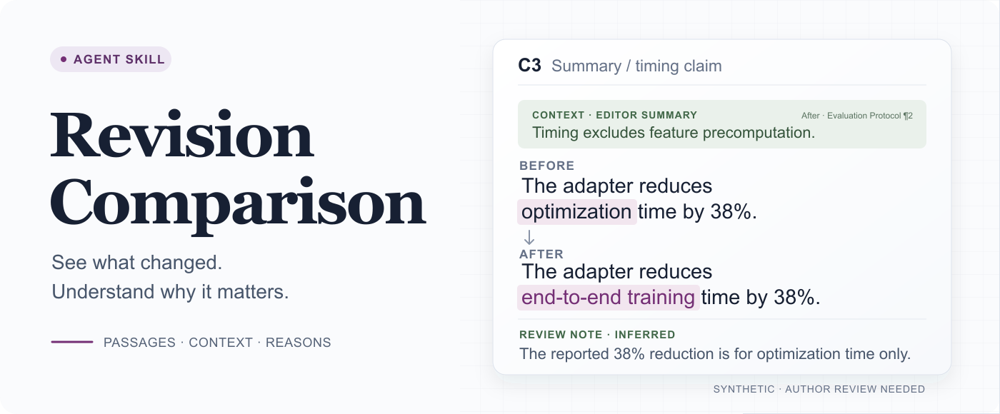
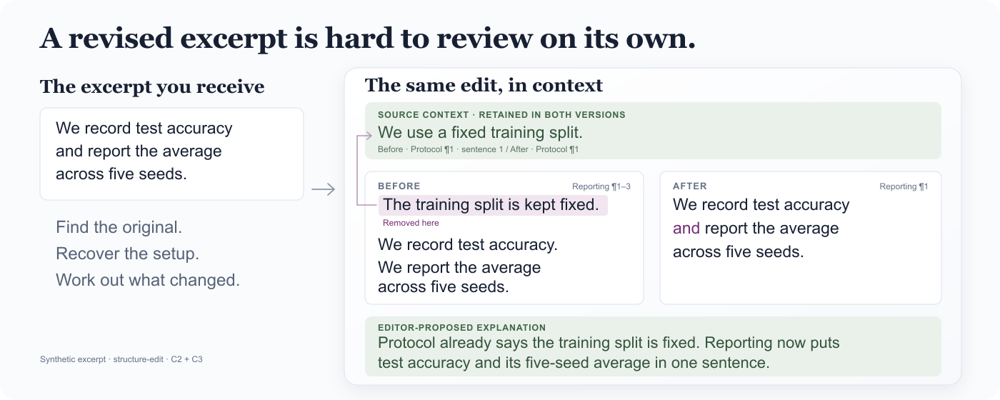
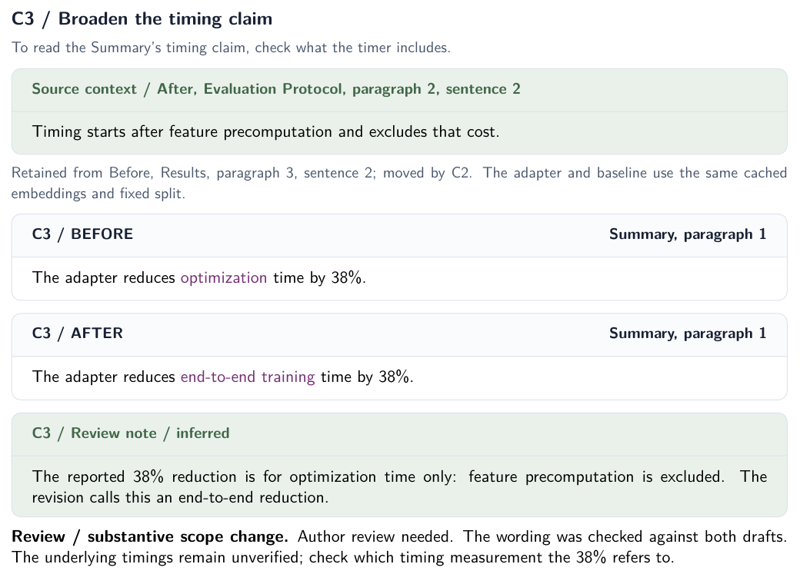
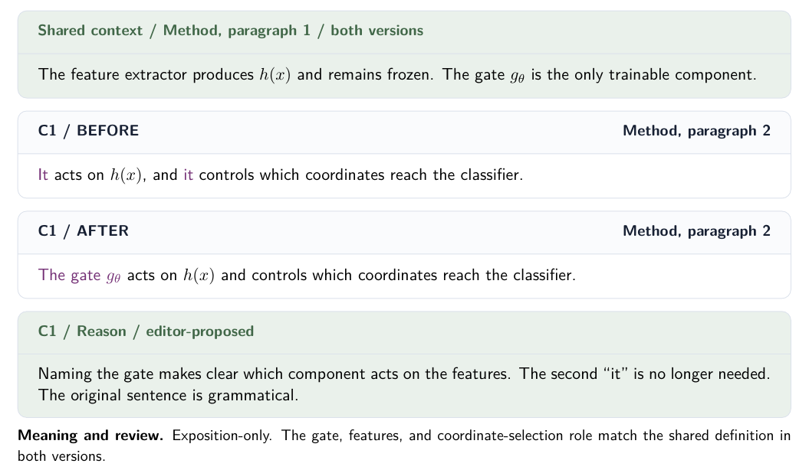
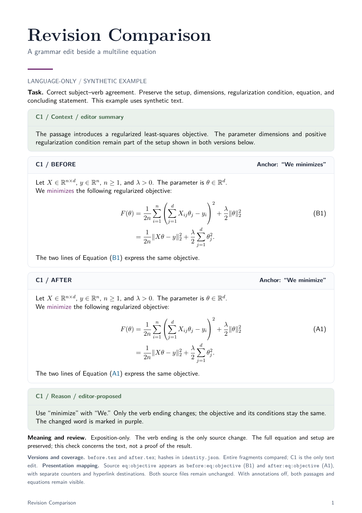

# Revision Comparison

<p align="center">
  <picture>
    <source media="(max-width: 600px)" srcset="assets/readme-hero-readable-mobile.png">
    
  </picture>
</p>

<p align="center">
  <a href="#why-this-skill">Why</a> ·
  <a href="#install">Install</a> ·
  <a href="#examples">Examples</a> ·
  <a href="#quick-start">Quick start</a> ·
  <a href="#how-it-works">How it works</a> ·
  <a href="skills/revision-comparison/SKILL.md">Skill instructions</a> ·
  <a href="LICENSE">MIT license</a>
</p>

Revision Comparison is an agent skill for reviewing manuscript revisions in context. It brings original and revised passages, relevant context, and revision notes together, so you can decide which edits to keep.

## Why this skill

<p align="center">
  <picture>
    <source media="(max-width: 600px)" srcset="assets/readme-why-readable-mobile.png">
    
  </picture>
</p>

An edited passage alone leaves you reconstructing the change. The comparison puts the original, revision, relevant context, and explanation in one place. [Read this example](examples/structure-edit/comparison.md).

## Install

Requires Git and Python 3.8+. **We recommend installing LaTeX for PDF reports.** Choose your agent and run one block below to install the skill with PDF support. Start from a directory that does not already contain `revision-comparison-skill`.

### Codex

```sh
git clone https://github.com/Raiden-Zhu/revision-comparison-skill.git &&
  python3 revision-comparison-skill/scripts/install.py --agent codex --with-pdf
```

### Claude Code

```sh
git clone https://github.com/Raiden-Zhu/revision-comparison-skill.git &&
  python3 revision-comparison-skill/scripts/install.py --agent claude-code --with-pdf
```

The `--with-pdf` option reuses an existing LaTeX installation and adds missing theme packages. If LaTeX is absent, it installs [TinyTeX](https://yihui.org/tinytex/) in your user directory. A small PDF build checks the setup. [PDF setup details](#pdf-setup).

Markdown reports work without LaTeX; omit `--with-pdf` to install only the skill.

After installation, invoke `$revision-comparison` in Codex or `/revision-comparison` in Claude Code. If it does not appear, reload the agent or start a new session. [Already cloned, project installation, or custom path?](#advanced-installation)

The repository is currently private, so you need GitHub access to clone it. The installer leaves existing installations unchanged.

### Try an example

Open the cloned repository in your agent and paste:

```text
Use revision-comparison in compare mode.
Before: examples/contextual-review/before.md
After: examples/contextual-review/after.md
Preserve both inputs and compare both complete files.
Save the report in a new directory under review/example-run/.
Also export a PDF using the included theme and keep the LaTeX source.
```

For a Markdown-only report, omit the PDF export line.

## Examples

PDF reports from synthetic examples. Click a preview to open the PDF.

**Same number, broader claim · synthetic ML revision**

The number stays at 38%, but `optimization time` becomes `end-to-end training time`. The report shows the timing definition from another section: the clock starts after feature precomputation.

[Open the two-page PDF](examples/contextual-review/comparison-readable.pdf) · [Markdown report](examples/contextual-review/comparison.md) · [Before](examples/contextual-review/before.md) / [After](examples/contextual-review/after.md) · [LaTeX](examples/contextual-review/comparison-readable.tex)

<p align="center">
  <a href="examples/contextual-review/comparison-readable.pdf"></a>
</p>

The report also shows a shorter training description (**C1**) and two reporting paragraphs moved and combined (**C2**). The timing claim (**C3**) needs closer review.

<details>
<summary>A simpler language-only proposal</summary>

[Open PDF](examples/language-edit/comparison-readable.pdf) · [Full page](examples/language-edit/comparison-readable-preview.png) · [LaTeX](examples/language-edit/comparison-readable.tex)

<p align="center">
  <a href="examples/language-edit/comparison-readable.pdf"></a>
</p>

</details>

<details>
<summary>Mathematical text: a grammar correction with the full equation preserved</summary>

[Open PDF](examples/math/comparison-styled-readable.pdf) · [Editable LaTeX](examples/math/comparison-styled-readable.tex)

<p align="center">
  <a href="examples/math/comparison-styled-readable.pdf"></a>
</p>

</details>

<details>
<summary>More examples and source files</summary>

| Example | What to look for | Open |
| --- | --- | --- |
| Contextual review | Check what a timing claim includes; follow its definition across sections | [Report](examples/contextual-review/comparison.md) · [Full page](examples/contextual-review/comparison-readable-preview.png) · [Before](examples/contextual-review/before.md) · [After](examples/contextual-review/after.md) |
| Language edit | Make clear that the gate acts on the features; keep the extractor frozen | [Report](examples/language-edit/comparison.md) · [Before](examples/language-edit/before.md) · [After](examples/language-edit/after.md) |
| Structure edit | Track moved and merged passages | [Report](examples/structure-edit/comparison.md) · [Before](examples/structure-edit/before.md) · [After](examples/structure-edit/after.md) |
| Meaning review | Find a removed assumption and check whether a rewritten objective means the same thing | [Report](examples/semantic-review/comparison.md) · [Before](examples/semantic-review/before.md) · [After](examples/semantic-review/after.md) |
| Mathematical text | Preserve the full equation and its conditions | [Report](examples/math/comparison.md) · [Before](examples/math/before.tex) · [After](examples/math/after.tex) |

Each example includes its source files and their hashes. The banner shows the exact before-and-after sentences from C3, with a short summary of the timing definition. The full report quotes that definition and gives its location. PDF previews are rendered from the reports. The [desktop](assets/readme-hero-readable.svg) and [mobile](assets/readme-hero-readable-mobile.svg) banner sources are editable.

</details>

## Quick start

Open your manuscript project in the agent and paste a prompt. Replace the sample paths with your own.

### Compare two drafts

```text
Use revision-comparison in compare mode.
Before: drafts/method-v1.tex
After: drafts/method-v2.tex
Scope: the feature-extraction subsection.
Save the Markdown comparison as review/method-comparison/comparison.md.
Explain the differences in English. Preserve both supplied versions.
```

### Propose a language edit

```text
Use revision-comparison in propose-and-compare mode on paper/method.tex.
Scope: the feature-extraction subsection. Editing scope: language-only.
Goal: clarify which operation acts on the frozen features.
Preserve claims, notation, equations, numbers, and citations.
Use the optional academic style profile.
Save the Markdown comparison as review/method-proposal/comparison.md.
Do not apply the proposal to the manuscript.
```

Open `comparison.md` to review the changes by ID. The output includes copies of your inputs and, for a proposed edit, the exact revised text. Paste these prompts into your agent.

## How it works

`compare` preserves the supplied versions and shows their differences, with concerns reported separately. `propose-and-compare` writes a revision within your requested scope and compares it with the original. The optional academic profile guides the writing.

The report distinguishes reasons supplied by the author from the agent's own interpretation. For an existing revision, the agent labels its own interpretation as inferred when no author explanation is available. Language-only proposals preserve claims, notation, numbers, equations, citations, and document structure. Structural edits follow the scope you request; changes to claims or mathematics need supporting evidence. See the [skill instructions](skills/revision-comparison/SKILL.md) for the editing rules.

### More prompts

**Polishing during rebuttal:** use reviewer comments to explain the editing goal, with the manuscript as the source for passages and scientific conditions.

```text
Use revision-comparison in propose-and-compare mode on paper/method.tex.
Read notes/reviewer-comments.md as supporting context.
Scope: the paragraph describing the timing measurement.
Editing scope: language-only.
Goal: clarify which costs the reported timing includes.
Preserve claims, conditions, equations, numbers, and citations.
Save the proposal and comparison in a new directory under review/rebuttal/.
Also export a PDF using the included theme and retain the LaTeX source.
Leave the supplied manuscript unchanged.
```

**Grammar across a manuscript:** give the entry file and ask the agent to check all included text. Large documents may need several passes; the report should state which sections were checked.

```text
Use revision-comparison in propose-and-compare mode on paper/main.tex.
Follow the manuscript's included files in reading order.
Editing scope: language-only.
Brief: correct grammar and punctuation throughout the manuscript.
Retain sentence structure where possible and preserve terminology,
author voice, claims, equations, numbers, and citations.
Save the proposal and comparison in review/grammar/; do not apply edits.
Record covered sections and any text you could not inspect.
```

**Use paper notes as context:** keep the manuscript as the baseline. Notes can explain a definition or goal; they do not replace the original passage.

```text
Use revision-comparison in propose-and-compare mode on paper/intro.tex.
Read notes/paper-context.md for the intended audience and definitions.
Editing scope: language-only. Goal: clarify the motivation paragraph.
Identify which context comes from the notes and which from the manuscript.
Save a Markdown comparison in review/intro/; do not apply edits.
```

### Apply selected edits

To apply an edit, tell the agent which revised version or change IDs to use.

```text
Apply C1 and C3 from review/method-proposal/comparison.md to
paper/method.tex. Keep the remaining passages as they are.
Preserve a baseline and deliver a clean manuscript.
```

Applied edits produce a clean manuscript by default. For LaTeX, you can also ask for revision marks and English notes that can be switched off.

## Read the report

The overview states the editing goal, when supplied, and the sections covered. Each change shows the original and revised passages, their locations, the relevant context, and an explanation.

Context may be a neighboring sentence, a definition, or a condition from another section. Quoted context includes its location; editor summaries are labeled and kept separate from quotations. When needed material is missing, the report says what could not be checked.

Each change has an ID such as C1, so you can discuss or select it without finding the passage again. Section names and quoted anchors help you locate it in the manuscript; paragraph or line numbers are included where reliable.

| Label | PDF annotation | Meaning |
| --- | --- | --- |
| Added | Blue text | New content, with insertion context |
| Rewritten | Purple text | Replaced wording or content |
| Moved/Reformatted | Black content, green annotation | A location or presentation change |
| Deleted | Original passage and a deletion reason | Content removed from the revision |
| Unchanged | Black text | Retained content |

Labels and IDs carry the meaning even when colors are unavailable. Markdown uses the same locations and Before/After structure. Ordinary prose can use bold for aligned changes; colored text and `diff` syntax highlighting depend on the reader. The PDF theme provides consistent colors and card layouts.

<details>
<summary>A compact Markdown presentation (synthetic example)</summary>

**Context · Evaluation Protocol:** Timing starts after feature precomputation and excludes that cost.

**Before · Summary:** The adapter reduces **optimization** time by 38%.

**After · Summary:** The adapter reduces **end-to-end training** time by 38%.

**Review note · inferred:** The reported 38% reduction is for optimization time only. Check which timing measurement the revised claim refers to.

Bold is presentation markup. Exact source copies remain in the comparison package; equations and LaTeX source can use fenced blocks to preserve their characters.

</details>

A useful explanation says what changed and how it affects the passage. For example, naming the gate tells the reader which component acts on the features. “More academic” alone does not explain an edit.

For a whole-document comparison, the coverage summary lists the sections compared, unchanged, or left out.

## Meaning and confidence

The report tells you whether an edit changes only the wording, preserves the meaning, changes a claim, or needs closer review. It also states what was checked against the supplied sources. This is a review of the edits, not a scientific validation of the manuscript.

The agent keeps justified confidence and uncertainty. Missing evidence is flagged rather than used to silently weaken a claim. A proved theorem can retain proof language; empirical claims stay within the conditions tested.

When a revision changes an assumption, inequality, comparison, or result value, the report shows the change and checks its support within the requested scope. Definitions or conditions from other sections are included when needed to understand it.

## Optional academic style

The optional [academic style profile](skills/revision-comparison/references/academic-style.md) favors direct wording, clear explanations, and a connected argument while preserving the author's voice. It applies when proposing revisions.

Academic Humanizer and research-paper-writing informed the profile. It is self-contained; neither skill is required to install or use it. Its purpose is clear academic writing, not avoiding AI-use disclosure.

The documentation is in English. Manuscript language follows the target document, and comparison explanations can use the language you request.

## Formats and limits

- **Markdown:** the default, editable report.
- **LaTeX/PDF:** an optional PDF with editable LaTeX source, compilation checks, and page-layout inspection. See [rendering guidance](skills/revision-comparison/references/rendering.md).
- **Other documents:** use the host's available reading and export capabilities. Native Word Track Changes is not implemented by this repository.

The agent needs readable sources. If it cannot read a passage, formula, or reference reliably, it reports what is missing.

The included [LaTeX theme](skills/revision-comparison/assets/comparison-style.tex) uses the banner's navy headings, green context and reason cards, subtle borders, and purple revision marks. It changes presentation only. Stacked cards can continue across pages; formulas retain their size and content. PDF export needs a working LaTeX toolchain with the packages listed in the rendering guide.

To request this export, add to your prompt:

```text
Also export comparison.pdf using the included visual theme.
Keep the editable LaTeX source and inspect the rendered pages.
```

## Advanced installation

The installer copies the complete [`skills/revision-comparison`](skills/revision-comparison) directory, including its references and PDF assets. Run the commands below from the cloned repository root.

### PDF setup

Add `--with-pdf` to any installation command to set up LaTeX as well. This can be repeated for an existing skill installation; the skill files are preserved.

```sh
python3 scripts/install.py --agent codex --with-pdf
```

The setup checks for a LaTeX compiler and the [theme's packages](skills/revision-comparison/references/rendering.md#latex-and-pdf), adds missing packages through TeX Live or MiKTeX, and compiles a small report with context cards and an equation. It does not upgrade the rest of your TeX installation or change your shell configuration. An older or restricted TeX installation may need attention from its package manager before setup can finish; failures keep the skill available for Markdown reports.

If no compiler is found, setup downloads the official TinyTeX bundle for macOS, Linux (x86-64 or ARM64), or Windows. It installs in `~/.local/share/revision-comparison/TinyTeX`, without replacing another distribution. Linux and macOS need Perl to install TeX packages. Downloads require internet access.

To check an existing setup without downloading or installing anything:

```sh
python3 skills/revision-comparison/scripts/setup_pdf.py --check
```

The check prints the compiler's full path and the test PDF location. New skill installations include the same helper, so your agent can find this toolchain even when it is not on `PATH`. If you keep an older skill installation, use the repository helper above and give your agent the printed compiler path. Manuscripts with additional fonts, languages, or custom packages may need further dependencies.

### Already cloned

Choose one:

```sh
python3 scripts/install.py --agent codex
```

```sh
python3 scripts/install.py --agent claude-code
```

### Install in one project

Replace `/absolute/path/to/project` with an existing project directory.

Codex:

```sh
python3 scripts/install.py --scope project --project "/absolute/path/to/project"
```

Claude Code:

```sh
python3 scripts/install.py --agent claude-code --scope project --project "/absolute/path/to/project"
```

| Agent | User installation | Project installation |
| --- | --- | --- |
| Codex | `~/.agents/skills/revision-comparison` | `<project>/.agents/skills/revision-comparison` |
| Claude Code | `~/.claude/skills/revision-comparison` | `<project>/.claude/skills/revision-comparison` |

### Custom paths and other agents

Use `--dest` to choose the installation directory:

```sh
python3 scripts/install.py --dest "/custom/skills/revision-comparison"
```

For an older Codex setup that discovers skills in `CODEX_HOME/skills`:

```sh
python3 scripts/install.py --dest "${CODEX_HOME:-$HOME/.codex}/skills/revision-comparison"
```

The installer refuses an existing destination, including a symbolic link, and reports its location. With `--with-pdf`, it can check PDF support for an existing Revision Comparison installation while preserving the skill files. Review an existing installation before updating it. There is no force-overwrite option; a copy failure retains the partial directory for inspection.

Other agents that can read files can follow [`SKILL.md`](skills/revision-comparison/SKILL.md) and its references directly. Whether the agent discovers the skill automatically depends on its host. Python is needed only for the installer. To install manually, copy the whole skill directory.

```sh
python3 scripts/install.py --help
```

## Repository layout

```text
skills/revision-comparison/
  SKILL.md
  agents/openai.yaml
  references/academic-style.md
  references/rendering.md
  assets/annotations.tex
  assets/comparison-style.tex
  scripts/setup_pdf.py
examples/
  contextual-review/  before, after, comparison, PDF preview
  language-edit/       before, after, comparison, PDF preview
  structure-edit/      before, after, comparison
  semantic-review/    before, after, comparison
  math/               before, after, comparison
evaluations/cases.md
scripts/install.py
tests/test_install.py
tests/test_pdf_setup.py
assets/readme-hero-readable.svg       editable desktop banner
assets/readme-hero-readable-mobile.svg  editable mobile banner
LICENSE
```

The [evaluation cases](evaluations/cases.md) cover common mistakes in revision comparisons. Contributions should use synthetic or explicitly shareable material and follow the editing and source-preservation rules in `SKILL.md`. To check the installer without touching your actual skill directories:

```sh
python3 -B -m unittest discover -s tests -p 'test_*.py' -v
```

The tests use isolated destinations under `.scratch/` and retain them for inspection. Network and package-installation actions are mocked; they do not install LaTeX on your machine.

## License

MIT. See [LICENSE](LICENSE).
