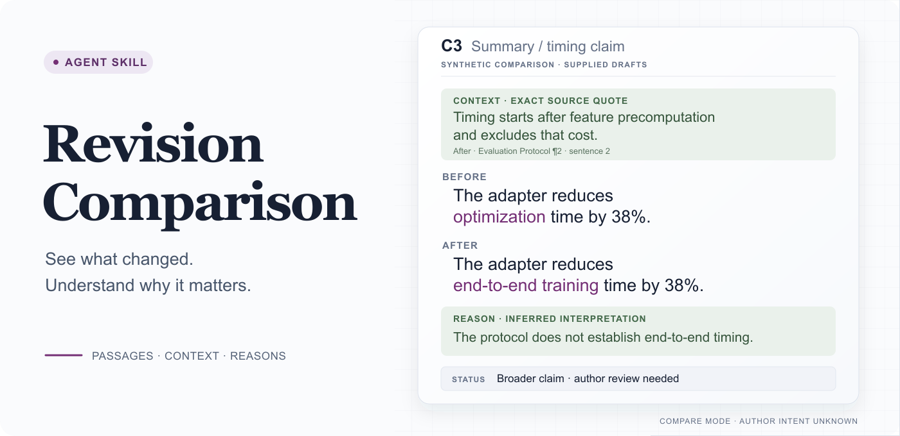
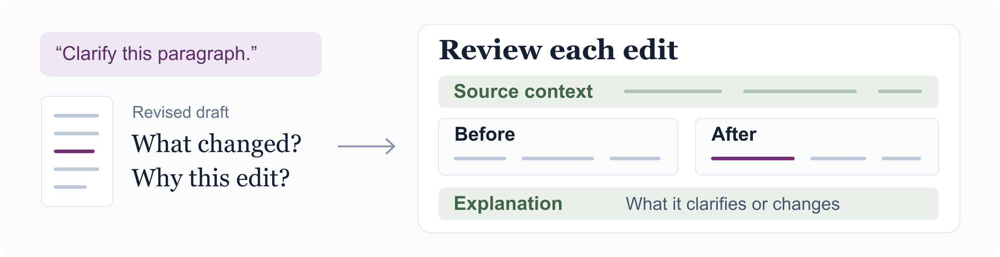
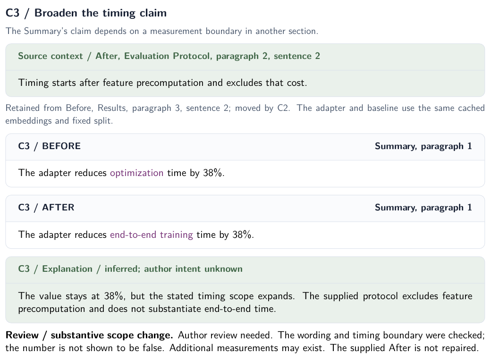
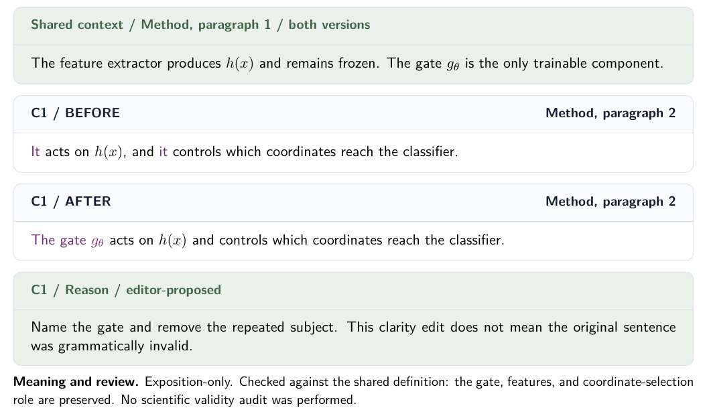
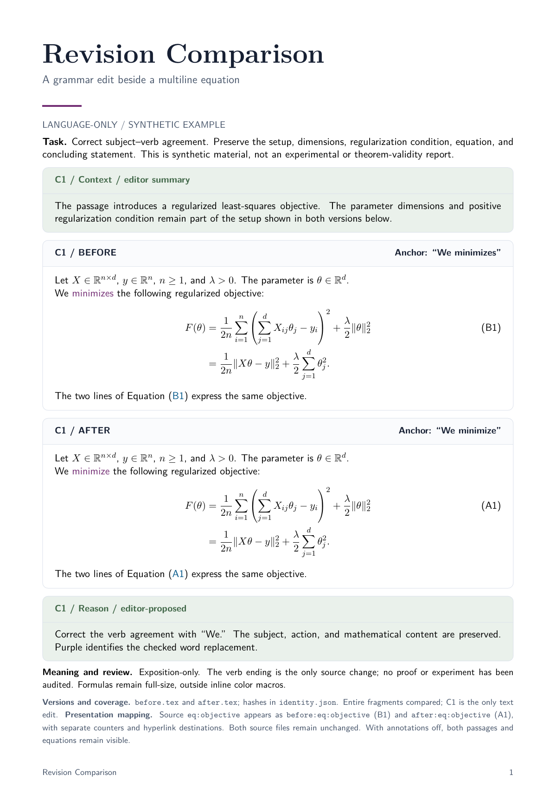

# Revision Comparison

<p align="center">
  <picture>
    <source media="(max-width: 600px)" srcset="assets/readme-hero-context-mobile.png">
    
  </picture>
</p>

<p align="center">
  <a href="#why-this-skill">Why</a> ·
  <a href="#install">Install</a> ·
  <a href="#examples">Examples</a> ·
  <a href="#quick-start">Quick start</a> ·
  <a href="#how-it-works">How it works</a> ·
  <a href="skills/revision-comparison/SKILL.md">Skill instructions</a> ·
  <a href="LICENSE">MIT license</a>
</p>

An agent skill for reviewing academic revisions. Compare two drafts, or propose a revision from one draft and an editing goal. Markdown is the default; PDF export is optional.

## Why this skill

<p align="center">
  <picture>
    <source media="(max-width: 600px)" srcset="assets/readme-why-mobile.png">
    
  </picture>
</p>

After an AI edit, I want to compare the original and revised passages with enough context to understand the change. This skill keeps the passages and their explanations together, so each edit is easier to review.

## Install

Requires Git and Python 3.8+. Choose one block and run it from a directory that does not already contain `revision-comparison-skill`.

### Codex

```sh
git clone https://github.com/Raiden-Zhu/revision-comparison-skill.git &&
  python3 revision-comparison-skill/scripts/install.py --agent codex
```

### Claude Code

```sh
git clone https://github.com/Raiden-Zhu/revision-comparison-skill.git &&
  python3 revision-comparison-skill/scripts/install.py --agent claude-code
```

Start a new agent session, then select `$revision-comparison` in Codex or invoke `/revision-comparison` in Claude Code. [Already cloned, project installation, or custom path?](#advanced-installation)

While the repository is private, cloning requires your normal GitHub access. Existing installations are preserved.

## Examples

Actual PDF exports from synthetic examples. Click a preview to open the PDF.

**Same number, broader claim · synthetic ML revision**

`Optimization time` becomes `end-to-end training time`, with the same 38% reduction. The report brings in the timing protocol from another section: feature precomputation is excluded.

[Open the two-page PDF](examples/contextual-review/comparison.pdf) · [Full report](examples/contextual-review/comparison.md) · [Before](examples/contextual-review/before.md) / [After](examples/contextual-review/after.md) · [LaTeX](examples/contextual-review/comparison.tex)

<p align="center">
  <a href="examples/contextual-review/comparison.pdf"></a>
</p>

The full report also traces a useful language edit (**C1**) and two reporting paragraphs moved and merged into one (**C2**). It distinguishes those improvements from the claim that needs review (**C3**).

<details>
<summary>A simpler language-only proposal</summary>

[Open PDF](examples/language-edit/comparison.pdf) · [Full page](examples/language-edit/comparison-preview.png) · [LaTeX](examples/language-edit/comparison.tex)

<p align="center">
  <a href="examples/language-edit/comparison.pdf"></a>
</p>

</details>

<details>
<summary>Mathematical text: a grammar correction with the full equation preserved</summary>

[Open PDF](examples/math/comparison-styled.pdf) · [Editable LaTeX](examples/math/comparison-styled.tex)

<p align="center">
  <a href="examples/math/comparison-styled.pdf"></a>
</p>

</details>

<details>
<summary>More examples and source files</summary>

| Example | What to look for | Open |
| --- | --- | --- |
| Contextual review | Read a changed claim against a moved protocol; distinguish scope changes from useful edits | [Report](examples/contextual-review/comparison.md) · [Full page](examples/contextual-review/comparison-preview.png) · [Before](examples/contextual-review/before.md) · [After](examples/contextual-review/after.md) |
| Language edit | Name the acting component; preserve the frozen-extractor condition | [Report](examples/language-edit/comparison.md) · [Before](examples/language-edit/before.md) · [After](examples/language-edit/after.md) |
| Structure edit | Track moved and merged passages | [Report](examples/structure-edit/comparison.md) · [Before](examples/structure-edit/before.md) · [After](examples/structure-edit/after.md) |
| Meaning review | Expose a removed condition and an uncertain objective reformulation | [Report](examples/semantic-review/comparison.md) · [Before](examples/semantic-review/before.md) · [After](examples/semantic-review/after.md) |
| Mathematical text | Preserve the full equation and its conditions | [Report](examples/math/comparison.md) · [Before](examples/math/before.tex) · [After](examples/math/after.tex) |

Each example records the source identities. The banner illustrates C3 from the contextual review using exact sentences and a located source quote. The PDF excerpt is rendered from the actual report. The [desktop](assets/readme-hero-context.svg) and [mobile](assets/readme-hero-context-mobile.svg) SVG sources are editable.

</details>

## Quick start

Open your manuscript project in the agent and paste a prompt. Replace the sample paths with your own.

### Compare two drafts

```text
Use revision-comparison in compare mode.
Before: drafts/method-v1.tex
After: drafts/method-v2.tex
Scope: the feature-extraction subsection.
Save the Markdown comparison as review/method-comparison/comparison.md.
Explain the differences in English. Preserve both supplied versions.
```

### Propose a language edit

```text
Use revision-comparison in propose-and-compare mode on paper/method.tex.
Scope: the feature-extraction subsection. Editing scope: language-only.
Goal: clarify which operation acts on the frozen features.
Preserve claims, notation, equations, numbers, and citations.
Use the optional academic style profile.
Save the Markdown comparison as review/method-proposal/comparison.md.
Do not apply the proposal to the manuscript.
```

Open `comparison.md` to review the changes by ID. Inputs are preserved as snapshots; a proposal also includes its authoritative revised text. These are prompts for your agent, not terminal commands.

<details>
<summary>Try the included example without a manuscript</summary>

**Try the included material:** open the cloned repository in your agent and paste this prompt. No manuscript is needed.

```text
Use revision-comparison in compare mode.
Before: examples/contextual-review/before.md
After: examples/contextual-review/after.md
Scope: both complete files. Preserve the supplied versions.
Save a new Markdown comparison as review/example-run/comparison.md.
```

</details>

## How it works

`compare` preserves both supplied versions, including any errors, and reports concerns separately. `propose-and-compare` creates one revised version within your editing scope, then traces that same text throughout the report. The optional academic profile guides that writing step.

Author explanations are labeled as provided reasons. If the agent interprets someone else's edit without an explanation, the reason is labeled as inferred. Language-only proposals preserve claims, notation, numbers, equations, citations, and document structure. Structural work needs an authorized scope; scientific changes need relevant evidence. See the [core instructions](skills/revision-comparison/SKILL.md) for the contract.

### More prompts

**Grammar across a manuscript:** provide the entry file and ask for coverage of its included text. Large documents may need several passes; the report should state which sections were covered.

```text
Use revision-comparison in propose-and-compare mode on paper/main.tex.
Follow the manuscript's included files in reading order.
Editing scope: language-only.
Brief: correct grammar and punctuation throughout the manuscript.
Retain sentence structure where possible and preserve terminology,
author voice, claims, equations, numbers, and citations.
Save the proposal and comparison in review/grammar/; do not apply edits.
Record covered sections and any text you could not inspect.
```

**Use paper notes as context:** keep the manuscript as the baseline. Notes can explain a definition or goal; they do not replace the original passage.

```text
Use revision-comparison in propose-and-compare mode on paper/intro.tex.
Read notes/paper-context.md for the intended audience and definitions.
Editing scope: language-only. Goal: clarify the motivation paragraph.
Identify which context comes from the notes and which from the manuscript.
Save a Markdown comparison in review/intro/; do not apply edits.
```

### Apply selected edits

Applying changes is independent of the two content modes. Request it explicitly and identify the version or changes to apply.

```text
Apply C1 and C3 from review/method-proposal/comparison.md to
paper/method.tex. Keep the remaining passages as they are.
Preserve a baseline and deliver a clean manuscript.
```

If you want annotations inside an English manuscript, request them separately. The skill can use switchable annotations and English revision notes for supported LaTeX workflows. Approving a clean integration does not automatically request visible review notes.

## Read the report

The overview explains what the revision is trying to achieve and what it covers. Each change unit then identifies the passage's role in its section and supplies only the definitions or neighboring context needed to understand that particular edit.

Context comes from the supplied document or supporting material. Quote a needed definition or neighboring passage with its location; a distant assumption may need its own source pointer. Label an editor summary as a summary and an assigned section role as an editorial judgment. Neither replaces the exact before-and-after quotations, including any original errors. If required context is unavailable, report that limit rather than inventing a condition. Repeating the overview under every change makes a report harder to read.

Each unit keeps the original passage, revised passage, and reason close together. Locations combine a section with a faithful anchor; reliable line numbers or paragraph IDs can supplement it. Stable IDs let you discuss or approve a change without searching for it again.

| Label | Presentation | Meaning |
| --- | --- | --- |
| Added | Blue text | New content, with insertion context |
| Rewritten | Purple text | Replaced wording or content |
| Moved/Reformatted | Black content, green annotation | A location or presentation change |
| Deleted | Original passage and a deletion reason | Content removed from the revision |
| Unchanged | Black text | Retained content |

Labels and IDs carry the meaning even when colors are unavailable. Markdown renderers vary in their support for colored text; the report remains readable without color.

A reason should name the problem and benefit: an undefined term, unclear referent, repeated explanation, changed comparator, or removed condition. “More academic” alone does not explain an edit.

For whole-document comparisons, a coverage summary identifies which sections were compared, retained, or excluded. A local comparison does not imply a full-paper audit.

## Meaning and confidence

The report distinguishes exposition changes, equivalent reformulations, substantive changes, and uncertain cases. These descriptions do not by themselves certify scientific correctness. Verification status records what could actually be checked from the available sources.

Preserve justified confidence as well as justified uncertainty. Missing evidence or context does not authorize silent weakening; flag what remains unverified. A theorem can retain proof language, while an empirical interpretation still needs its measured scope.

Checks focus on the changed units and the context needed to assess them, including distant definitions or conditions. When a revision changes an assumption, inequality, comparison, or result value, the report makes that change visible and checks its support within the requested scope. It does not invent an experiment or silently expand into a manuscript-wide scientific review.

## Optional academic style

The [academic style profile](skills/revision-comparison/references/academic-style.md) supports author voice, direct prose, readable formalism, concise reasoning, and continuity between passages. It is optional and applies when proposing revisions.

Academic-Humanizer and research-paper-writing informed the separation between prose preferences and editing permissions. The profile is self-contained; neither skill is required to install or use it. It supports academic clarity rather than AI-detection or disclosure avoidance.

The documentation is in English. Manuscript language follows the target document, and comparison explanations can use the language you request.

## Formats and limits

- **Markdown:** the default, editable comparison artifact.
- **LaTeX/PDF:** an optional export with isolated labels/counters, compilation checks, and rendered-page inspection. See [rendering guidance](skills/revision-comparison/references/rendering.md).
- **Other documents:** use the host's available reading and export capabilities. Native Word Track Changes is not implemented by this repository.

The skill needs readable source material. If a reference, formula, or passage cannot be recovered faithfully, the agent should disclose the limitation rather than reconstruct it from a guess. Successful compilation validates rendering, not scientific claims.

The included [LaTeX theme](skills/revision-comparison/assets/comparison-style.tex) uses the banner's navy headings, green context and reason cards, subtle borders, and purple revision marks. It changes presentation only. Stacked cards can continue across pages; formulas retain their size and content. PDF export needs a working LaTeX toolchain with the packages listed in the rendering guide.

To request this export, add to your prompt:

```text
Also export comparison.pdf using the included visual theme.
Keep the editable LaTeX source and inspect the rendered pages.
```

## Advanced installation

The installer copies the complete [`skills/revision-comparison`](skills/revision-comparison) directory, including its references and PDF assets. Run the commands below from the cloned repository root.

### Already cloned

Choose one:

```sh
python3 scripts/install.py --agent codex
```

```sh
python3 scripts/install.py --agent claude-code
```

### Install in one project

Replace `/absolute/path/to/project` with an existing project directory.

Codex:

```sh
python3 scripts/install.py --scope project --project "/absolute/path/to/project"
```

Claude Code:

```sh
python3 scripts/install.py --agent claude-code --scope project --project "/absolute/path/to/project"
```

| Agent | User installation | Project installation |
| --- | --- | --- |
| Codex | `~/.agents/skills/revision-comparison` | `<project>/.agents/skills/revision-comparison` |
| Claude Code | `~/.claude/skills/revision-comparison` | `<project>/.claude/skills/revision-comparison` |

### Custom paths and other agents

An exact destination overrides the host and scope defaults:

```sh
python3 scripts/install.py --dest "/custom/skills/revision-comparison"
```

For an older Codex setup that discovers skills in `CODEX_HOME/skills`:

```sh
python3 scripts/install.py --dest "${CODEX_HOME:-$HOME/.codex}/skills/revision-comparison"
```

The installer refuses an existing destination, including a symbolic link, and reports its location. Review an existing installation before updating it. There is no force-overwrite option; a copy failure retains the partial directory for inspection.

Other file-capable agents can read [`SKILL.md`](skills/revision-comparison/SKILL.md) directly and follow its relative references. Automatic discovery depends on the host. The skill itself needs no Python runtime; Python is used only by the optional installer. Manual installation should copy the whole skill directory.

```sh
python3 scripts/install.py --help
```

## Repository layout

```text
skills/revision-comparison/
  SKILL.md
  agents/openai.yaml
  references/academic-style.md
  references/rendering.md
  assets/annotations.tex
  assets/comparison-style.tex
examples/
  contextual-review/  before, after, comparison, PDF preview
  language-edit/       before, after, comparison, PDF preview
  structure-edit/      before, after, comparison
  semantic-review/    before, after, comparison
  math/               before, after, comparison
evaluations/cases.md
scripts/install.py
tests/test_install.py
assets/readme-hero-context.svg       editable desktop banner
assets/readme-hero-context-mobile.svg  editable mobile banner
LICENSE
```

The [evaluation cases](evaluations/cases.md) cover representative failure modes without requiring a separate evaluation framework. Contributions should use synthetic or explicitly shareable material and keep the core contract as the authority for editing permissions and fidelity. To check the installer without touching your actual skill directories:

```sh
python3 -B -m unittest discover -s tests -p test_install.py -v
```

The tests use isolated destinations under `.scratch/install-tests/` and retain them for inspection.

## License

MIT. See [LICENSE](LICENSE).
